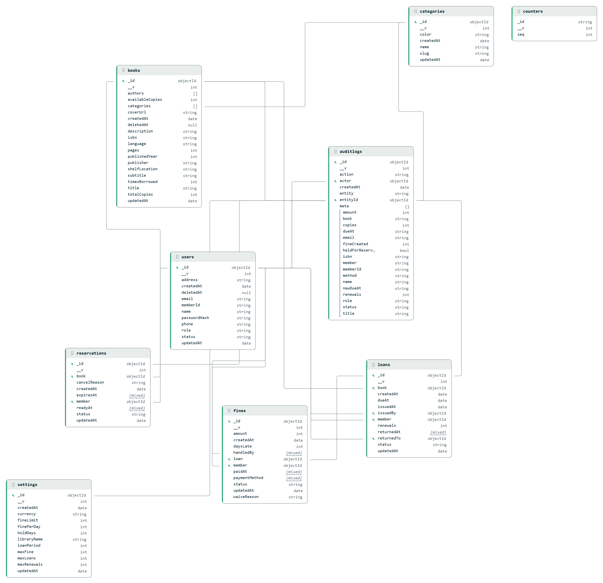
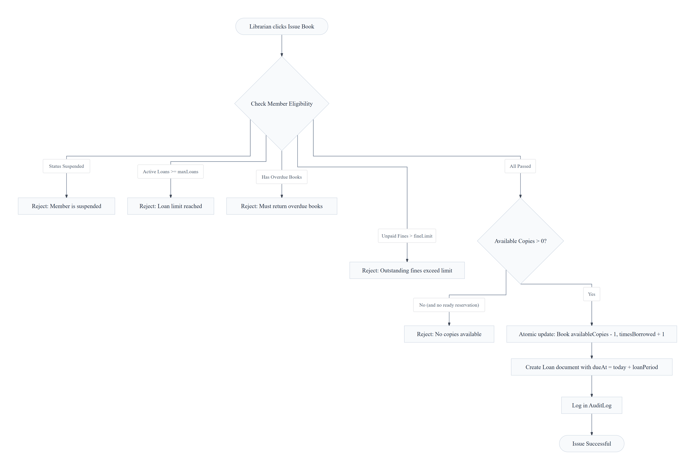

# Shelfwise — Modern Library Management System

> **Web Application Development Mini Project**  
> Built with the **MERN Stack + JavaScript** ; (MongoDB, Express.js, React.js with JSX, Node.js & Tailwind CSS).

---

## Summary

**Shelfwise** is a modern Library Management System developed using JavaScript on both the server (Back-end) and client(Front-end). It provides an end-to-end web solution for managing a modern library:
-**Catalogue Management:** Searchable catalogue, Quickly find items by title or author, Organize items with tags and categories, Real-time tracking of available stock and copies
-**Member & Staff Management:** Auto-generated member ID cards (`LIB-00001`), role-based access control (Admin, Librarian, Member), and status suspension controls.
-**Circulation Desk:** Real-time book issue, returns, and renewals enforcing strict business rules and atomic copy inventory updates.
-**Reservation Queues:** Automatic first-come first-served reservations.
-**Automated Fines:** Late return penalty calculation (LKR currency), fine thresholds that block checkout.
-**Analytics & Reporting:** 30-day activity trends, most borrowed books, overdue audits, and one-click CSV data export.


---

## Database Architecture & Entity Relationship Diagram (ER Diagram)



---

## Pre-Configured Accounts

The database comes pre-seeded with realistic demo accounts:

| Role | Email | Password | Access Privileges |
|---|---|---|---|
| **Admin** | `admin@shelfwise.test` | `Admin@123` | System settings, staff accounts, audit logs, full circulation & catalogue |
| **Librarian** | `librarian@shelfwise.test` | `Librarian@123` | Front-desk circulation, book CRUD, member registration, fine collection |
| **Member** | `member@shelfwise.test` | `Member@123` | Personal loans, renew books, reserve copies, check fine balance |


---
## Workflow of Fines and Reserving Books 



---

### 2. Fine Calculation 
The system dynamically calculates overdue penalties upon book check-in without relying on hard-coded rules.
* **Formula:** `Fine Amount = min(lateDays * finePerDay, maxFinePerLoan)`
* **Behavior:** 
  * On-time returns (late days <= 0) generate no fine records.
  * Live estimates for active overdue books are computed on-the-fly.
  * Fine rates and caps are dynamically fetched from the centralized MongoDB `Settings` collection.

Values from Setting model (defaults):
finePerDay = LKR 10
maxFine = LKR 500
fineLimit = LKR 200 (if unpaid fines exceed this, future borrowing is blocked)   

### 3. Reservation Queue Mechanism
When all physical copies of a requested title are currently checked out, the system manages waitlist priorities transparently.
* **Queue Placement:** Members can place a hold on out-of-stock items, joining an ordered, timestamp-based queue (e.g., position #1 in line).
* **Automated Fulfillment:** When a borrowed book is returned to the circulation desk, the system automatically inspects pending reservations, locking and assigning the available copy to the earliest eligible patron in line.

---

### CRUD Operations Summary
* **CREATE (POST):** Adds new records (Ex: Registering members with auto-generated sequential IDs like `LIB-00001`, Adding books with metadata and cover images, Creating categories, Issuing new loans, and Placing book reservations).
* **READ (GET):** Retrieves and filters data from MongoDB collections (Ex: Full-text search on books by title, author, or ISBN, Active overdue reports, and Member-specific views).
* **UPDATE (PATCH/PUT):** Modifies existing records while enforcing business rules (Ex: Updating book or category details, Modifying member profiles, Toggling member status, Processing book returns, Renewing active loans, and Marking fines as paid or waived).
* **DELETE (DELETE):** Removes or archives resources while preserving historical integrity (Ex: Soft-deleting books and member accounts, and Deleting unused categories with dependency checks).
  
---

## Step-by-Step Setup & Run

### Prerequisites
- **Node.js**: v18 or newer installed ([Download Node.js](https://nodejs.org/))
- **MongoDB**: Either running locally on `mongodb://127.0.0.1:27017` or a free MongoDB Atlas connection URI

---

### Quick Start

From the project root directory:

```bash
# 1. Run setup (installs packages and creates server/.env from .env.example)
npm run setup

# 2. Seed database with demo books, members, loans, and fines
npm run seed

# 3. Start both Server & Client concurrently
npm run dev
```

Then open browser at:
- **Web Application:** : [http://localhost:5173](http://localhost:5173)
- **API Health Check:** : [http://localhost:4000/api/v1/health](http://localhost:4000/api/v1/health)

---

## REST API Specification Summary

| Method | Endpoint | Access | Description |
|---|---|---|---|
| `POST` | `/api/v1/auth/register` | Public | Self-registration for members (auto assigns `LIB-xxxxx`) |
| `POST` | `/api/v1/auth/login` | Public | Authenticates user and returns JWT token |
| `GET` | `/api/v1/auth/me` | Logged In | Returns logged-in user profile, active loans, and fines |
| `GET` | `/api/v1/books` | Public / Logged In | Search books by keyword, category, and availability |
| `GET` | `/api/v1/books/isbn-lookup/:isbn` | Staff | Fetches metadata & covers from Open Library API |
| `POST` | `/api/v1/books` | Staff | Creates new book record |
| `PATCH` | `/api/v1/books/:id` | Staff | Updates book details and copy counts |
| `DELETE` | `/api/v1/books/:id` | Admin | Soft-deletes book (blocked if active loans exist) |
| `GET` | `/api/v1/categories` | Logged In | Lists all categories and count of assigned books |
| `GET` | `/api/v1/members` | Staff | Lists members with search & active loan counts |
| `GET` | `/api/v1/members/:id/eligibility` | Staff | Checks whether member is permitted to borrow |
| `POST` | `/api/v1/loans` | Staff | Issues book to member with full rule checks |
| `POST` | `/api/v1/loans/:id/return` | Staff | Returns book, calculates fines, & checks reservations |
| `POST` | `/api/v1/loans/:id/renew` | Staff / Member | Renews loan if not overdue and no queue waiting |
| `POST` | `/api/v1/reservations` | Member / Staff | Places reservation on unavailable book |
| `POST` | `/api/v1/fines/:id/pay` | Staff | Records fine payment via Cash, Card, or Other |
| `POST` | `/api/v1/fines/:id/waive` | Staff | Waives fine with recorded justification |
| `GET` | `/api/v1/dashboard/stats` | Staff | Returns aggregation metrics, charts, & due alerts |
| `GET` | `/api/v1/reports/:name/export.csv` | Staff | Exports report data as a downloadable CSV file |
| `GET / PATCH` | `/api/v1/settings` | Admin | Reads or updates library policies & limits |
| `GET` | `/api/v1/audit-logs` | Admin | Returns system audit logs |

---

This project is developed as an academic submission for the my **Web Application Development Mini Project**.  
