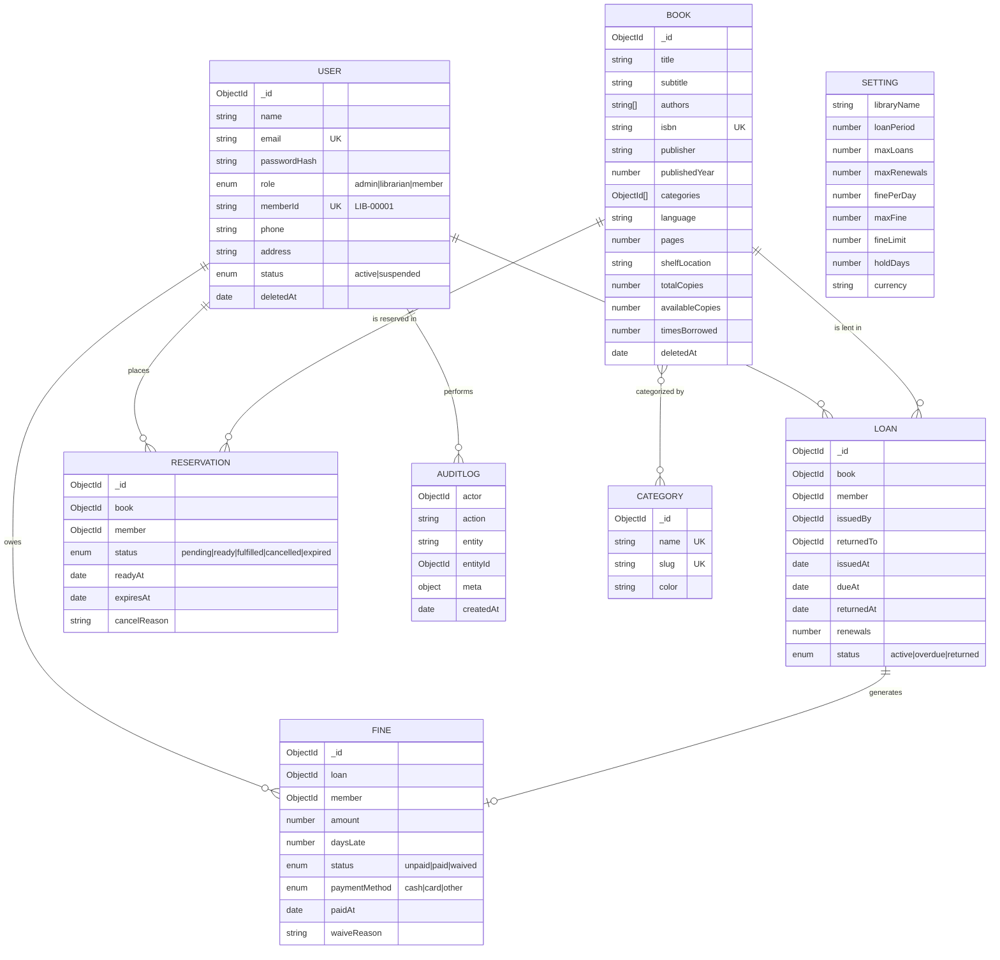

# Shelfwise — Modern Library Management System

> **Web Application Development Mini Project**  
> Built with the **MERN Stack + JavaScript** (MongoDB, Express.js, React.js with JSX, Node.js & Tailwind CSS).

---

## Summary

**Shelfwise** is a modern Library Management System developed using JavaScript on both the server (Back-end) and client(Front-end). It provides an end-to-end web solution for managing a modern library:
-**Catalogue Management:** Searchable catalogue, Quickly find items by title or author, Organize items with tags and categories, Real-time tracking of available stock and copies
-**Member & Staff Management:** Auto-generated member ID cards (`LIB-00001`), role-based access control (Admin, Librarian, Member), and status suspension controls.
-**Circulation Desk:** Real-time book issue, returns, and renewals enforcing strict business rules and atomic copy inventory updates.
-**Reservation Queues:** Automatic first-come first-served reservations.
-**Automated Fines:** Late return penalty calculation (LKR currency), fine thresholds that block checkout.
-**Analytics & Reporting:** 30-day activity trends, most borrowed books, overdue audits, and one-click CSV data export.
-**Crud Operations:** Book Management, Member Management, Circulation Desk, Reservations Queue, Fines Management, Categories works with CRUD operations. 
-Ex: create:Add Book,Register Members, add categories, Search books and Filter by category availability, Search or filter Members, Update any details,Delete categories which are not available, etc.

---

## Database Architecture & Entity Relationship Diagram (ER Diagram)



---

## Pre-Configured Accounts

The database comes pre-seeded with realistic demo accounts:

| Role | Email | Password | Access Privileges |
|---|---|---|---|
| **Admin** | `admin@shelfwise.test` | `Admin@123` | System settings, staff accounts, audit logs, full circulation & catalogue |
| **Librarian** | `librarian@shelfwise.test` | `Librarian@123` | Front-desk circulation, book CRUD, member registration, fine collection |
| **Member** | `member@shelfwise.test` | `Member@123` | Personal loans, renew books, reserve copies, check fine balance |


---

## Step-by-Step Setup & Run

### Prerequisites
- **Node.js**: v18 or newer installed ([Download Node.js](https://nodejs.org/))
- **MongoDB**: Either running locally on `mongodb://127.0.0.1:27017` or a free MongoDB Atlas connection URI

---

### Quick Start

From the project root directory:

```bash
# 1. Run setup (installs packages and creates server/.env from .env.example)
npm run setup

# 2. Seed database with demo books, members, loans, and fines
npm run seed

# 3. Start both Server & Client concurrently
npm run dev
```

Then open browser at:
- **Web Application:** : [http://localhost:5173](http://localhost:5173)
- **API Health Check:** : [http://localhost:4000/api/v1/health](http://localhost:4000/api/v1/health)

---

## REST API Specification Summary

| Method | Endpoint | Access | Description |
|---|---|---|---|
| `POST` | `/api/v1/auth/register` | Public | Self-registration for members (auto assigns `LIB-xxxxx`) |
| `POST` | `/api/v1/auth/login` | Public | Authenticates user and returns JWT token |
| `GET` | `/api/v1/auth/me` | Logged In | Returns logged-in user profile, active loans, and fines |
| `GET` | `/api/v1/books` | Public / Logged In | Search books by keyword, category, and availability |
| `GET` | `/api/v1/books/isbn-lookup/:isbn` | Staff | Fetches metadata & covers from Open Library API |
| `POST` | `/api/v1/books` | Staff | Creates new book record |
| `PATCH` | `/api/v1/books/:id` | Staff | Updates book details and copy counts |
| `DELETE` | `/api/v1/books/:id` | Admin | Soft-deletes book (blocked if active loans exist) |
| `GET` | `/api/v1/categories` | Logged In | Lists all categories and count of assigned books |
| `GET` | `/api/v1/members` | Staff | Lists members with search & active loan counts |
| `GET` | `/api/v1/members/:id/eligibility` | Staff | Checks whether member is permitted to borrow |
| `POST` | `/api/v1/loans` | Staff | Issues book to member with full rule checks |
| `POST` | `/api/v1/loans/:id/return` | Staff | Returns book, calculates fines, & checks reservations |
| `POST` | `/api/v1/loans/:id/renew` | Staff / Member | Renews loan if not overdue and no queue waiting |
| `POST` | `/api/v1/reservations` | Member / Staff | Places reservation on unavailable book |
| `POST` | `/api/v1/fines/:id/pay` | Staff | Records fine payment via Cash, Card, or Other |
| `POST` | `/api/v1/fines/:id/waive` | Staff | Waives fine with recorded justification |
| `GET` | `/api/v1/dashboard/stats` | Staff | Returns aggregation metrics, charts, & due alerts |
| `GET` | `/api/v1/reports/:name/export.csv` | Staff | Exports report data as a downloadable CSV file |
| `GET / PATCH` | `/api/v1/settings` | Admin | Reads or updates library policies & limits |
| `GET` | `/api/v1/audit-logs` | Admin | Returns system audit logs |

---

This project is developed as an academic submission for the my **Web Application Development Mini Project**.  
